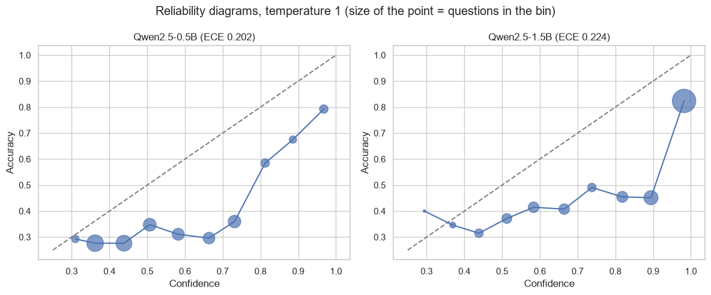
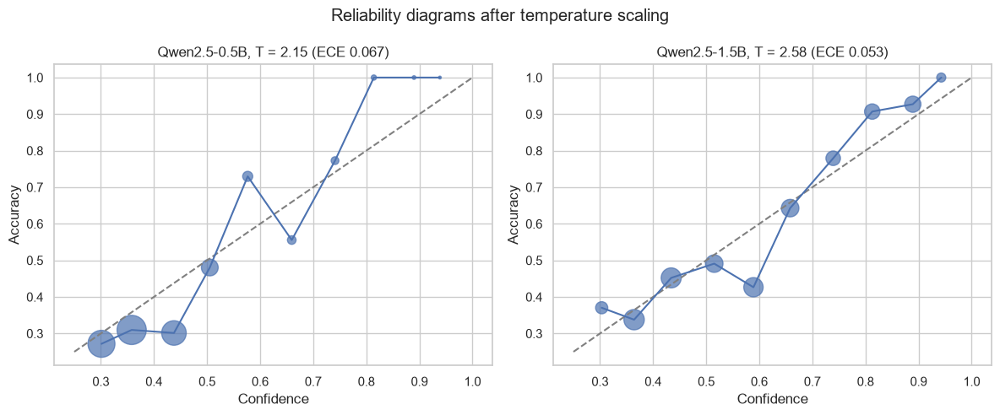
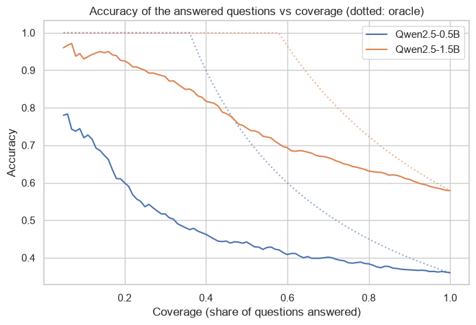

# Confidence calibration of small open-weight LLMs

Can we trust the probability that an LLM gives to its answer? I measure the calibration of Qwen2.5-0.5B and Qwen2.5-1.5B (instruct) on 1.000 MMLU questions, fix it with temperature scaling, use the confidence for selective prediction and compare it with the confidence the model says in words. Everything runs on CPU.

## Data
MMLU (Hendrycks et al., 2021): 1.000 random questions of the test set and 500 of the validation set (to fit the temperature), 57 subjects. The confidence is the softmax of the logits of the tokens A, B, C and D.

## Main results
- Accuracy 36% (0.5B) and 58% (1.5B). Both models are overconfident, with an ECE of 0.20 and 0.22: the 1.5B gives more than 95% of confidence to a third of the questions and is wrong in 15% of them.
- Temperature scaling (T = 2.2 and 2.6, fitted in validation) brings the ECE of the test set to 0.067 and 0.053 without changing any answer.
- The confidence ranks the questions: answering only the most confident 50%, the accuracy of the 1.5B goes from 58% to 75% (90% with the top 25%).
- The confidence the model writes in words is almost useless: it says 85% most of the time, ECE 0.25 and AUROC 0.55, against 0.75 for the token probabilities.





## How to run

```
pip install -r requirements.txt
jupyter notebook llm_calibration.ipynb
```

The logits are saved in `data/`, so the notebook only runs the models if these files are deleted (around 3 hours on a laptop CPU for both models).

---
Alejandro Lezcano Osorio | Universidad EIA (Colombia) and Rennes School of Business (France)
